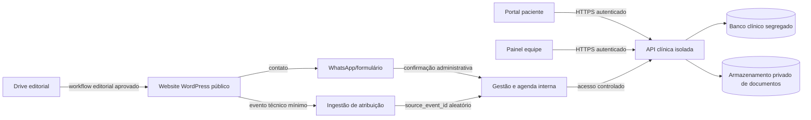

# Arquitetura SOTOMA — separação de camadas
Estado: proposta; requer prova técnica de hospedagem e WordPress.
## Mapa

## Componentes
1. **WP público:** páginas, categorias, artigos, formulários mínimos e tags de analytics sanitizadas. Não armazena prontuário. Plugin fino `sotoma-site-bridge` responsável por CTAs e eventos de origem.
2. **Painel de gestão/profissionais:** recomendado como aplicação privada independente ou plugin `sotoma-management` em instalação WordPress separada e endurecida, nunca no WP público; decisões técnicas ficam condicionadas a prova de autorização/isolamento. Gestão operacional e clínica em módulos isolados.
3. **Portal do paciente:** interface separada em `cliente`, compartilhando API autenticada, nunca cookies/sessões públicas do WordPress.
4. **Serviço seguro:** API com autorização por recurso (paciente+profissional+papel+finalidade), storage privado, auditoria e backups; dados clínicos não são expostos a WP REST público, Google Drive editorial nem GA4.
## Arquitetura do plugin (proposta)
```text
sotoma-core/
  modules/
    acquisition/         # eventos sanitizados, contato validado
    operations/          # agenda, capacidade, fila administrativa
    professionals/       # credenciamento e perfis internos
    patient-portal/      # documentos e agenda sob autorização
    clinical-bridge/     # integração SRES/prescrição validada; feature flag OFF
    editorial-bridge/    # somente documentos públicos e metas editoriais
    audit/               # trilha imutável, sanitizada
  contracts/
  tests/
```
Critério: painéis podem compartilhar monorepo e design system, não privilégios ou bancos de dados indiscriminados. Não prometer que um único plugin de WordPress resolve segurança clínica por si só.
## Entidades mínimas
`lead` (contato administrativo não clínico), `lead_touch` (origem), `appointment` (data/status), `professional` (credenciamento), `availability_slot` (capacidade), `patient_identity` (separada), `professional_patient_grant` (acesso explícito), `document_metadata` (proveniência/visibilidade), `audit_event`, `editorial_item`. Chaves de associação entre CRM e paciente clínico devem ser protegidas e jamais enviadas a analytics.
## Arquivos
Upload permitido somente após login, verificação de paciente e permissão; validar tipo real, MIME e tamanho, nome aleatório, escaneamento de malware, quarentena, storage não público, links de acesso temporários com autorização servidor a cada download, logs sem conteúdo. Não enviar arquivos clínicos à Media Library do WordPress nem Drive editorial.
## Receitas
Fase inicial apenas disponibilizar, com permissão, documento de prescrição válido emitido externamente por profissional habilitado. NÃO gerar prescrição/assinatura em modelo caseiro; integração futura deve seguir Anvisa SNCR e requisitos de validação conforme tipo de receita.
## Disponibilidade e isolamento
Cada portal com hostname, configuração, TLS, política de sessão e autenticação próprios; preferir MFA para profissionais, segregação por ambiente, cabeçalhos seguros, auditoria, WAF, backups e teste de recuperação. Acesso administrativo tem limites e justificação.
## Proibições
Sem dados clínicos em URLs, UTM, analytics, e-mail marketing, GitHub, planilhas, ambientes de staging, screenshot de debug. Sem publicação de painel sem pentest e revisão jurídica/técnica.